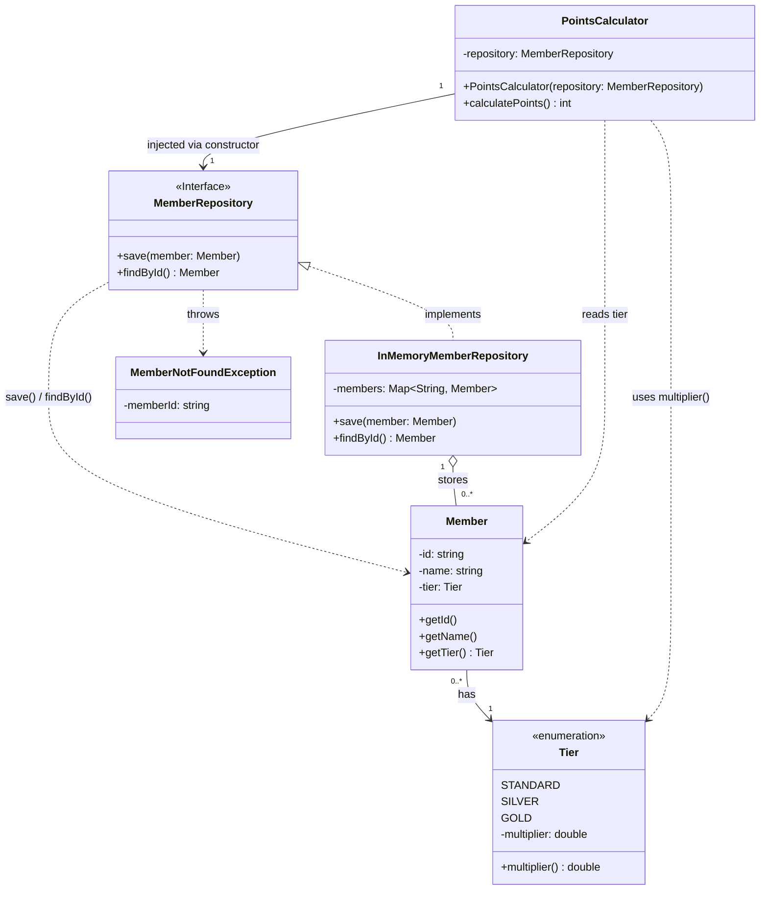

# Analysis.md
This file contains what is actually wrong with the code (its smells, anti-patterns, and SOLID violations) and, separately, spots which of the AI-generated tests pass without really testing anything, ranked by what matters most.

Rank No. | Issue | Where | Root Cause | Code Smell / SOLID violated |
---| --------| ------|-----------|----------|
| 1.| Silently swallowed exceptions | PointsCalculator.java:32–35 (catch block) |  The catch block returns 0 for all exceptions. Unknown members, bad tiers and code bugs all become “0 points” with no log or alert. | Swallowed exception / error hiding; overly broad catch |
2.| High-level class creates its own low-level dependency | PointsCalculator.java:7 | new InMemoryMemberRepository() inside the class. The MemberRepository interface exists, but callers and tests can’t pass in a different one. | Dependency Inversion violation; hidden dependency; tight coupling|
3.| Repository returns null for a missing member | Demo.java; new PointsCalculator(), InMemoryMemberRepository.java  | members.get(id) returns null, which causes a NullPointerException on getTier() that row 1 then swallows | Null return instead of a domain exception (MemberNotFoundException) |
4.| Wrong monetary type | PointsCalculator.calculatePoints(String, double); (int) casts on lines 14 and 20 | | |
5.|Tests can’t control their dependency | Whole test class | The calculator creates its own repository, so tests depend on hidden seed data | Hidden test fixture; not isolated (a consequence of code row 2) |
6.| Business rules untested | Whole test class | No exact value per tier, no test of the bonus (including the 500.00 vs 500.01 boundary), no test of rounding (150 at SILVER gives 22; 99.99 gives 9), and no test that the bonus is applied after the multiplier | Missing boundary and equivalence-class tests |
7.| Invalid input untested | Whole test class | No tests for zero, negative, NaN or Infinity amounts, or for an unknown or lowercase tier | Missing edge-case tests |
8.| Test names don’t match what the tests do | calculatesGoldPoints, awardsPointsForAPurchase | The first calculates nothing. The second uses a SILVER member but never checks the 1.5× multiplier. | Misleading test names |
9.| Magic test IDs | All three tests | "m1", "m2" and "m3" hide the tier, so the reader has to open the repository | Mystery guest: Does not follow the Arrange Act Assert format of testing |
10.| No tests for the repository | InMemoryMemberRepository | Neither finding a member nor the null-for-unknown case is covered | Untested class |
11.| Poor test structure | Whole test class | No @ParameterizedTest for the tier table, no Arrange-Act-Assert layout, no @DisplayName | Test readability and duplication |
12.| Wildcard imports | PointsCalculatorTest.java:5–6 | Assertions.* and Mockito.* hide where each method comes from | Readability/style nit (not a SOLID violation)  |

## Which AI-Generated Test Passes without Testing Anything
```calculatesGoldPoints()```: It mocks the method instead and returns a value. So the branch for computing the points for Gold tier is actually never tested.

## Which Problem is the Most Serious for this Code and Why
Silently swallowed exceptions is the most serious for this code. It is a live production bug and produces wrong results for users and the business. Unknown members, bad tiers and code bugs all become “0 points” with no log or alert.


## Initial output
The initial output from running the initial code.

```text
Awarded 10 points to Kofi Mensah
Result m1 (STANDARD), GHS 100  -> 10
Awarded 50 points to Ama Owusu
Result m2 (GOLD), GHS 250      -> 50
Result unknown member, GHS 100 -> 0
```


## Design Rationale
### Refactored Design




### Key refactoring decisions

**1. The calculator receives its repository; it doesn't create one.**
`PointsCalculator` used to create `new InMemoryMemberRepository()` inside itself, even though a `MemberRepository` interface already existed. It now takes a `MemberRepository` through its constructor. The calculator depends only on the interface (Dependency Inversion), so each test can pass in a repository it controls instead of relying on hidden seed data.

**2. The caller creates the members; the repository starts empty.**
The repository used to fill itself with `m1`, `m2` and `m3` in its constructor. A test couldn't see which tier `"m2"` was without opening another class. Now the caller creates members and stores them with `save()`. Each test sets up exactly the members it uses, in plain view, and gets a new repository so tests can't affect each other.

**3. Failures are reported, not hidden.**
The original code wrapped everything in `catch (Exception e) { return 0; }`. An unknown member, a bad tier and a real bug all came out as "0 points," with no error. This was the most serious defect, because it gave customers wrong balances and nobody could see it happening. The changes:
- `findById()` throws `MemberNotFoundException` instead of returning `null`. The exception is part of the `MemberRepository` interface's contract, so every implementation must keep it, including a future database repository, and no caller ever has to check for `null`.
- The catch-all block is gone. A failure now reaches the caller, which can decide how to handle it.

**4. The tier is an enum that holds its own multiplier.**
Tiers used to be free-text strings checked by an `if/else` chain. A typo such as `"gold"` matched no branch and silently earned ×1. `Tier` is now an enum, and each constant stores its multiplier (`STANDARD(1.0)`, `SILVER(1.5)`, `GOLD(2.0)`). The calculator looks up `member.getTier().multiplier()` instead of branching on a string. An invalid tier can't be represented, and the calculator has one path through it instead of three.

I considered `Member` subclasses (`GoldMember`, `SilverMember`) and rejected them:
- The tiers differ by one number, not by behaviour, so three classes would add structure without adding meaning.
- A member's tier would be fixed by their class, so upgrading a member would mean replacing the object.
- Keeping a subclass *and* a tier value would store the same fact twice, and the two could disagree.

**5. Each class has one job.**

| Class | Responsibility |
|---|---|
| `PointsCalculator` | Applies the points rules. It no longer prints to the console; it returns a result and the caller decides what to do with it. |
| `MemberRepository` | Stores and finds members. |
| `Member` | Holds a member's identity and tier. |
| `Tier` | Knows each tier's multiplier. |

## How the design absorbs the coming rule change

Brightline is about to add a new tier. Under this design:

- **If the new tier differs only by multiplier,** adding it is one line in `Tier`, for example `PLATINUM(3.0)`. `PointsCalculator`, `Member` and the repository don't change (Open/Closed). The tests change by one row in the parameterized tier test.
- **If the new tier has rules of its own,** such as a different bonus, the change is still small. `Tier` gets one method that applies a tier's rules, for example `applyTo(basePoints, amount)`. The calculator calls that method instead of `multiplier()`, which is a one-line change. Java lets a single enum constant override a method with its own body, so `PLATINUM` can define its own rules while the other tiers keep the shared ones. The existing tiers don't change.


