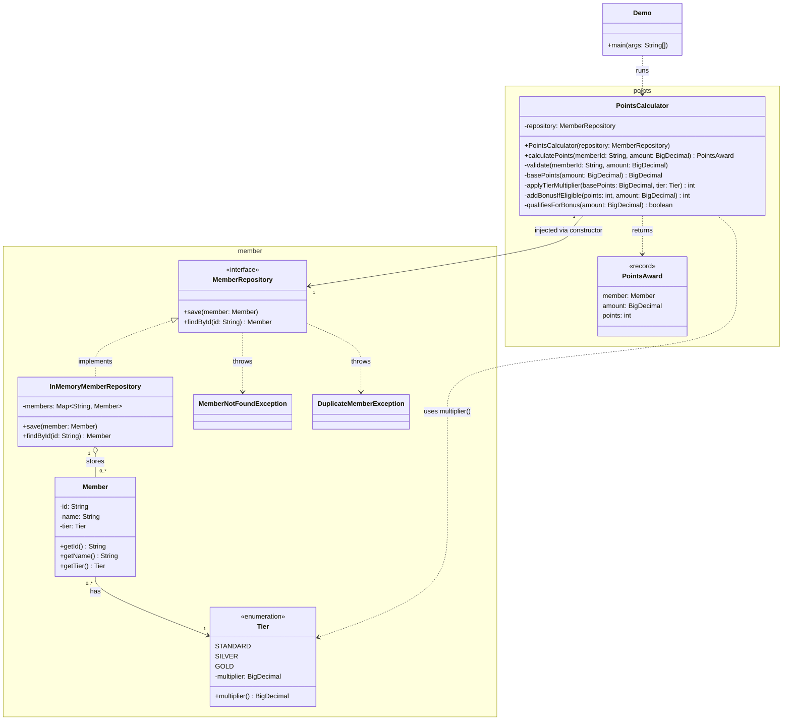

# Analysis.md
This file has two parts. The first records what was wrong with the original code (its smells, anti-patterns and SOLID violations) and which of the original AI-generated tests passed without really testing anything, each ranked by what matters most. The second describes the refactored design and the reasoning behind it.

**These findings describe the original code, before the refactoring.** Everything from here down to "Initial output" refers to commit `f45bb4c`, the first commit in this repository. File paths and line numbers point into that version, not the current code.

## Code Issues Detected (Original Code)

| Rank No. | Issue | Where | Root Cause | Code Smell / SOLID violated |
|---|---|---|---|---|
| 1.| Silently swallowed exceptions | PointsCalculator.java:32–35 (catch block) |  The catch block returns 0 for all exceptions. Unknown members, bad tiers and code bugs all become “0 points” with no log or alert. | Swallowed exception / error hiding; overly broad catch |
| 2.| High-level class creates its own low-level dependency | PointsCalculator.java:7 | new InMemoryMemberRepository() inside the class. The MemberRepository interface exists, but callers and tests can’t pass in a different one. | Dependency Inversion violation; hidden dependency; tight coupling|
| 3.| Repository returns null for a missing member | Demo.java; new PointsCalculator(), InMemoryMemberRepository.java  | members.get(id) returns null, which causes a NullPointerException on getTier() that row 1 then swallows | Null return instead of a domain exception (MemberNotFoundException) |
| 4.| Wrong monetary type | PointsCalculator.calculatePoints(String, double); (int) casts on lines 14 and 20 | Money held in binary floating point, and points truncated by casts, so the rounding happens by accident rather than by a stated rule | Floating point for currency; implicit or undocumented rounding |
| 5.| No input validation | calculatePoints() and Member constructor| No guard clauses on amount, memberId or tier. GHS −100 gives −10 points, and Infinity gives Integer.MAX_VALUE + 50, which overflows to a negative number. | Missing guard clauses / no fail-fast |
| 6.| Tier stored as a String | Member.java:6; PointsCalculator.java:17–23 | "gold", "PLATINUM" and null are all accepted. An unknown tier silently gets the 1× rate, and a null tier throws a NullPointerException that becomes 0. | Primitive obsession|
| 7.| If/else chain on tier | PointsCalculator.java:17–23 | Every new tier means editing this method | Open/Closed violation; conditional on type code |
| 8.| Method does more than one thing | calculatePoints() | Looks up the member, calculates, applies the bonus and prints to System.out in one method | Single Responsibility violation |
| 9.| Magic numbers | PointsCalculator.java:14, 18, 20, 22, 26, 27 | 10, 1, 1.5, 2, 500 and 50 are unnamed business rules | Magic numbers which make the code difficult to understand |
| 10.| Constructor hard-codes seed data | InMemoryMemberRepository.java:10–14 | Demo/test members are baked into a production class  | Hard-coded test data in production code; constructor doing real work | 

## Testing Issues Detected (Original Code)
| Rank No. | Issue | Where | Root cause | Code smell / testing anti-pattern |
|---|---|---|---|---|
| 1. | Test mocks the class it is testing | `PointsCalculatorTest.calculatesGoldPoints` (lines 20–22) | Stubs `calculatePoints` to return 50, then asserts 50. No production code runs, so it passes even if the logic is broken. | Mocking the class under test (a self-fulfilling test); false confidence because 50 is the correct GOLD value |
| 2. | Assertion that can never fail | `awardsPointsForAPurchase` (line 29) | `assertNotNull` on a primitive `int` autoboxes to a non-null `Integer`, so 30, 0 and −999 all pass | Tautological assertion; inflates JaCoCo coverage for the SILVER path |
| 3. | Assertion too weak | `awardsPointsToAMember` (line 14) | `assertTrue(points > 0)` when the answer is exactly 10. A wrong divisor, multiplier or bonus still passes. | Weak or imprecise assertion (should be `assertEquals(10, points)`) |
| 4. | Failure path never tested | Whole test class | No test for an unknown member, `null` ID or `null` tier, so the silent "0 points" behaviour goes unnoticed | Missing negative/error-path tests |
| 5. | Tests can't control their dependency | Whole test class | The calculator creates its own repository, so tests depend on hidden seed data | Hidden test fixture; not isolated (a consequence of code row 2) |
| 6. | Business rules untested | Whole test class | No exact value per tier, no test of the bonus (including the 500.00 vs 500.01 boundary), no test of rounding (150 at SILVER gives 22; 99.99 gives 9), and no test that the bonus is applied after the multiplier | Missing boundary and equivalence-class tests |
| 7. | Invalid input untested | Whole test class | No tests for zero, negative, `NaN` or `Infinity` amounts, or for an unknown or lowercase tier | Missing edge-case tests |
| 8. | Test names don't match what the tests do | `calculatesGoldPoints`, `awardsPointsForAPurchase` | The first calculates nothing. The second uses a SILVER member but never checks the 1.5× multiplier. | Misleading test names |
| 9. | Magic test IDs | All three tests | `"m1"`, `"m2"` and `"m3"` hide the tier, so the reader has to open the repository | Mystery guest |
| 10. | No tests for the repository | `InMemoryMemberRepository` | Neither finding a member nor the `null`-for-unknown case is covered | Untested class |
| 11. | Poor test structure | Whole test class | No `@ParameterizedTest` for the tier table, no Arrange-Act-Assert layout, no `@DisplayName` | Test readability and duplication |
| 12. | Wildcard imports | `PointsCalculatorTest.java:5–6` | `Assertions.*` and `Mockito.*` hide where each method comes from | Readability/style nit (not a SOLID violation) |


## Which AI-Generated Test Pass without Testing Anything
```calculatesGoldPoints()```: It mocks the method instead and returns a value. So the branch for computing the points for Gold tier is actually never tested.

## Which Problem is the Most Serious for this Code and Why
Silently swallowed exceptions is the most serious for this code. It is a live production bug and produces wrong results for users and the business. Unknown members, bad tiers and code bugs all become “0 points” with no log or alert.


## Initial output
The initial output from running the initial code.

```text
Awarded 10 points to Kofi Mensah
Result m1 (STANDARD), GHS 100  -> 10
Awarded 50 points to Ama Owusu
Result m2 (GOLD), GHS 250      -> 50
Result unknown member, GHS 100 -> 0
```


## Refactored Design



## Design Rationale

### Key refactoring decisions

**1. The calculator receives its repository; it doesn't create one.**
`PointsCalculator` used to create `new InMemoryMemberRepository()` inside itself. It now takes a `MemberRepository` through its constructor (Dependency Inversion), and rejects `null` there (`constructorWithNullRepositoryFailsFast`). Unit tests pass in a Mockito mock of the interface, so they control exactly which member is returned and can check that the calculator looks a member up once and never saves (`looksUpMemberExactlyOnce`).

**2. The repository starts empty, and callers add members with `save()`.**
The repository used to seed `m1`, `m2` and `m3` in its constructor, so a test couldn't see a member's tier without opening another class. Each test now creates the members it needs, in plain view, with descriptive IDs such as `"gold-member"`. `save()` rejects a duplicate ID with `DuplicateMemberException` and keeps the original member, so a second save can't silently change a member's tier (`saveWithDuplicateIdKeepsOriginalMember`, `calculatePointsAfterRejectedDuplicateSaveUsesOriginalTier`).

**3. Failures are reported, not hidden.**
The original `catch (Exception e) { return 0; }` turned an unknown member, a bad tier and a real bug into "0 points". This was the most serious defect. Now:
- `findById()` throws `MemberNotFoundException` naming the missing ID instead of returning `null`. It is a checked exception (`domainExceptionsAreChecked`), so every caller has to deal with it.
- The calculator has no catch block. A not-found exception reaches the caller unchanged (`whenMemberNotFoundPropagatesMemberNotFoundException`), and so does any unexpected repository failure (`whenRepositoryThrowsRuntimeExceptionPropagatesIt`).
- Bad input fails before the repository is touched: a null or blank ID, or a null or negative amount, throws `IllegalArgumentException` (`Validation` tests use `verifyNoInteractions(repository)`).

**4. The tier is an enum that holds its own multiplier.**
Tiers used to be strings checked by an `if/else` chain, so `"gold"` silently earned ×1. `Tier` is now an enum, and each constant stores its multiplier as a `BigDecimal` (`STANDARD("1")`, `SILVER("1.5")`, `GOLD("2")`). The calculator calls `member.getTier().multiplier()` instead of branching. A misspelt tier can't be created (`valueOfIsCaseSensitive` rejects `"gold"`, `" GOLD"` and `"PLATINUM"`), and a `Member` can't be built with a null tier.

I considered `Member` subclasses (`GoldMember`, `SilverMember`) and rejected them. The tiers differ by one number, not by behaviour; upgrading a member would mean replacing the object; and a subclass plus a tier field would store the same fact twice.

**5. Money is `BigDecimal`, and every rounding rule is explicit and tested.**
`double` amounts and `(int)` casts made the rounding accidental. Each rule is now stated in code and fixed by a test:

| Rule | Test |
|---|---|
| One point per GHS 10, rounded down (GHS 99.99 → 9) | `forStandardMemberAwardsOnePointPerTenCedisRoundedDown` |
| Base points are rounded down *before* the multiplier (SILVER, GHS 19.99 → 1, not 2) | `truncatesBaseBeforeApplyingMultiplier` |
| Fractional points are dropped (SILVER, GHS 150 → 22) | `forSilverTruncatesFractionalPoints` |
| The bonus needs *more than* GHS 500, whatever the scale (`500.000` gets no bonus) | `atExactlyThresholdDoesNotAddBonus` |
| The bonus is added after the multiplier (GOLD, GHS 600 → 170, not 220) | `bonusIsAddedAfterMultiplierNotMultiplied` |
| Points that don't fit in an `int` throw instead of wrapping negative | `Overflow` tests |

The rule values live in named constants (`BASE_POINT_DENOMINATOR`, `LOYALTY_BONUS_THRESHOLD`, `LOYALTY_BONUS_POINTS`).

**6. The calculator returns a result; it doesn't print.**
`calculatePoints` used to print to `System.out` and return a bare `int`. It now returns a `PointsAward` record holding the member, the original amount and the points (`Award` tests), and `Demo` decides how to display it. The calculator has one job: applying the points rules.

| Class | Package | Responsibility |
|---|---|---|
| `PointsCalculator` | `points` | Applies the points rules and returns a `PointsAward` |
| `MemberRepository` | `member` | Stores and finds members; its contract is defined by `MemberRepositoryContractTest` |
| `Member` | `member` | Holds a valid member's identity and tier |
| `Tier` | `member` | Knows each tier's multiplier |
| `Demo` | root | Seeds sample members and prints the results |

**7. The code is grouped by feature into packages.**
The repository interface, its implementation and the points classes used to sit together in the root package `com.brightline.loyalty`, apart from the member types and exceptions they work with. The code is now split by feature:

| Package | Contents |
|---|---|
| `com.brightline.loyalty.member` | `Member`, `Tier`, `MemberRepository`, `InMemoryMemberRepository`, `MemberNotFoundException`, `DuplicateMemberException` |
| `com.brightline.loyalty.points` | `PointsCalculator`, `PointsAward` |
| `com.brightline.loyalty` | `Demo`, which wires the two together |

The repository interface now sits next to the member types it stores and the exceptions it declares, so the member domain and its storage contract are in one place. `points` depends on `member` (the calculator looks members up through `MemberRepository`).

The tests mirror the same packages. `InMemoryMemberRepositoryTest` and `MemberRepositoryContractTest` are in `member`, because the first extends the package-private contract test. `PointsCalculatorTest` and `PointsCalculatorIT` are in `points`.


## How the design absorbs the coming rule change

Brightline is about to add a new tier.

- **If the new tier differs only by multiplier,** the production change is one line in `Tier`, for example `PLATINUM("3")`. `PointsCalculator`, `Member` and the repository don't change (Open/Closed). The tests guide the rest:
  - `definesExactlyThreeTiers` fails on purpose. Its comment says to add the new tier's row to `multiplierMatchesSchemeRate`, so the new rate can't ship untested.
  - `multipliersIncreaseWithTierRank` checks that the new tier earns more than the one below it.
  - The `@EnumSource(Tier.class)` tests in `TierTest` and `MemberTest` cover the new tier automatically.
- **If the new tier has rules of its own,** such as a different bonus, `Tier` gets one method that applies a tier's rules, for example `applyTo(basePoints, amount)`, and the calculator calls it instead of `multiplier()`. A single enum constant can override that method with its own body, so only the new tier carries the new rule. The existing `Bonus` and `TierMultiplier` tests then prove the other tiers didn't change.
- **If the bonus threshold or amount changes,** it changes in one constant, and the `Bonus` boundary tests (GHS 499.99, 500, 500.01) show exactly which results move.

## What I kept, fixed and rewrote

### Production code

| Original | Decision | Why |
|---|---|---|
| `MemberRepository` interface | **Kept, extended and moved** | The abstraction was right but unused. Added `save()`, and declared `MemberNotFoundException` and `DuplicateMemberException` so every implementation shares the same failure contract. Moved from the root package into `member`, next to the types it stores. |
| `InMemoryMemberRepository` | **Fixed and moved** | Kept the `HashMap` storage. Removed the hard-coded seed data, replaced the `null` return with `MemberNotFoundException`, and added ID validation and the duplicate check. Moved into `member` with its interface. |
| `Member` | **Fixed** | Kept its shape (ID, name, tier, getters). Changed the tier from `String` to `Tier`, and made the constructor reject a null tier and a null or blank ID or name. |
| `PointsCalculator` | **Rewrote** | Almost every line had a defect: a self-created dependency, `double` money, the string `if/else` chain, the catch-all, printing and magic numbers. Only the business rules carried over, and each is now pinned by a test. It now lives in the new `points` package, with the `PointsAward` record it returns. |
| `Demo` | **Kept and fixed** | Still a runner for seeing the calculator work. It now creates its own members and does the printing that used to be in the calculator. |

### Tests

| Original test | Problem | Decision |
|---|---|---|
| `calculatesGoldPoints` | Mocked `PointsCalculator` itself, then asserted the value it had just stubbed. No production code ran. | **Rewrote.** The mock now stands in for the *repository*, and the real calculator computes GOLD at GHS 250 → 50 (`appliesTierMultiplier`). |
| `awardsPointsToAMember` | `assertTrue(points > 0)` passes for any positive value. | **Fixed.** Exact values replace it: STANDARD at GHS 100 → exactly 10, with boundaries either side (`BasePoints` tests). |
| `awardsPointsForAPurchase` | `assertNotNull` on an `int` can never fail, and the SILVER ×1.5 was never checked. | **Fixed.** SILVER at GHS 200 → exactly 30, and GHS 150 → 22 for the rounding case (`TierMultiplier` tests). |
| Mockito dependency | Used to mock the class under test. | **Kept,** but only to mock the calculator's collaborator. |

Tests added for behaviour the original suite never checked: unknown members, invalid input, the bonus boundary, rounding order and overflow (`PointsCalculatorTest`); valid and invalid tiers (`TierTest`); member validation (`MemberTest`); the domain exceptions (`DomainExceptionsTest`); the repository contract (`MemberRepositoryContractTest`, run by `InMemoryMemberRepositoryTest`); and the real calculator and repository working together (`PointsCalculatorIT`).

### How I checked the tests are meaningful

Passing tests aren't enough: the original suite passed while testing nothing. So the suite was checked in two ways:
- **JaCoCo:** every line and branch of `PointsCalculator`, `Member`, `Tier`, `InMemoryMemberRepository` and the exceptions is covered. `Demo` is a manual runner and has no unit tests.
- **PIT mutation testing:** PIT changes the production code (for example flipping `>` to `>=` on the bonus threshold) and reruns the tests. Every mutant outside `Demo` was killed (100% in both the `member` and `points` packages), so each tested line has an assertion that fails when the logic is wrong.

`mvn verify` runs 100 unit tests and 9 integration tests, all passing.

## Improvement beyond the brief: quality gates in the build

**Problem.** The original AI tests were green and would have shown decent coverage, yet proved nothing. The new suite is meaningful today, but nothing stops it decaying the same way when the next engineer adds the new tier with a weak test.

**What I added.** `mvn verify` now fails unless:
- **JaCoCo:** 100% of lines and branches are covered, which catches code no test runs.
- **PIT:** 100% of mutants are killed, which catches code that tests run but don't check.

**Value.** The points rules are all boundaries (the GHS 500 threshold, rounding order, bonus after multiplier), which is exactly where PIT's mutations land. When the new tier's rules arrive, they must be tested and checked before the build passes, without anyone having to remember.

## Final Program Output
```
Awarded 10 points to Kofi Mensah
Result m1 (STANDARD), GHS 100  -> 10
Awarded 50 points to Ama Owusu
Result m2 (GOLD), GHS 250      -> 50
2026-11-19 16:01:50 WARNING com.brightline.loyalty.Demo - Member (unknown) does not exist
com.brightline.loyalty.member.MemberNotFoundException: Member (unknown) does not exist
        at com.brightline.loyalty.member.InMemoryMemberRepository.findById(InMemoryMemberRepository.java:15)
        at com.brightline.loyalty.points.PointsCalculator.calculatePoints(PointsCalculator.java:26)
        at com.brightline.loyalty.Demo.main(Demo.java:42)
        at java.base/jdk.internal.reflect.DirectMethodHandleAccessor.invoke(DirectMethodHandleAccessor.java:104)
        at java.base/java.lang.reflect.Method.invoke(Method.java:565)
        at org.codehaus.mojo.exec.AbstractExecJavaBase.executeMainMethod(AbstractExecJavaBase.java:478)
        at org.codehaus.mojo.exec.ExecJavaMojo.executeMainMethod(ExecJavaMojo.java:142)
        at org.codehaus.mojo.exec.AbstractExecJavaBase.doExecClassLoader(AbstractExecJavaBase.java:453)
        at org.codehaus.mojo.exec.AbstractExecJavaBase.lambda$execute$0(AbstractExecJavaBase.java:317)
        at java.base/java.lang.Thread.run(Thread.java:1474)
```